# Détection d'intrusion réseau explicable – CSE-CIC-IDS2018

[](https://github.com/Farahgrissa/ids-xai-classification/actions/workflows/ci.yml)


Application web de classification explicable appliquée à la détection d'intrusion réseau.
Le système identifie les flux malveillants (force brute, déni de service, botnet) à partir de
statistiques de trafic, compare cinq modèles de classification et rend chaque décision interprétable
pour un analyste de sécurité.

Projet réalisé dans le cadre du module Data Mining (filières II3-IA et II3-IF), ENSI, année 2026-2027.

| Ressource | Lien |
|---|---|
| Application (Streamlit Community Cloud) | [ids-xai-classification.streamlit.app](https://ids-xai-classification.streamlit.app) |
| API (FastAPI, Render) | [ids-xai-api.onrender.com](https://ids-xai-api.onrender.com) — documentation interactive : [`/docs`](https://ids-xai-api.onrender.com/docs) |
| Notebook d'analyse | [`notebooks/projet_xai.ipynb`](notebooks/projet_xai.ipynb) |
| Synthèse (one-pager) | [`docs/one-pager.pdf`](docs/one-pager.pdf) |

---

## Sommaire

1. [Contexte et objectif](#contexte-et-objectif)
2. [Données](#données)
3. [Méthodologie](#méthodologie)
4. [Résultats](#résultats)
5. [Architecture](#architecture)
6. [Installation et exécution](#installation-et-exécution)
7. [API](#api)
8. [Limites et perspectives](#limites-et-perspectives)
9. [Références](#références)

---

## Contexte et objectif

Un centre opérationnel de sécurité (SOC) traite chaque jour des millions de flux réseau. Un système de
détection utile doit concilier deux exigences :

- **détecter les attaques** sans submerger les analystes de fausses alertes ;
- **justifier chaque alerte**, afin qu'elle puisse être vérifiée rapidement et que la décision reste
  compréhensible par un responsable non spécialiste.

Le projet couvre l'ensemble de la chaîne : acquisition automatique des données, exploration,
préparation, modélisation, évaluation, explicabilité et exposition du modèle via une API.

## Données

**Source.** CSE-CIC-IDS2018 (Communications Security Establishment & Canadian Institute for
Cybersecurity), trafic capturé sur une infrastructure AWS et publié sur le
[Registry of Open Data on AWS](https://registry.opendata.aws/cse-cic-ids2018). Les fichiers sont lus
directement depuis le bucket S3 public, sans authentification.

**Périmètre.** Trois journées couvrant trois familles d'attaques :

| Journée | Attaques | Famille |
|---|---|---|
| 14/02/2018 | FTP-BruteForce, SSH-Bruteforce | Accès (force brute) |
| 16/02/2018 | DoS Hulk, DoS SlowHTTPTest | Impact (déni de service) |
| 02/03/2018 | Bot | Persistance (botnet) |

**Échantillon.** 1,5 % de chaque journée (échantillonnage aléatoire reproductible, lecture par blocs),
soit 47 187 flux bruts et **37 395 flux après nettoyage**, dont 27,3 % d'attaques.

**Cible.** Variable binaire : flux normal (0) ou attaque (1). Le type d'attaque est conservé
uniquement pour la stratification et l'analyse des erreurs.

## Méthodologie

### 1. Nettoyage et qualité des données
- Suppression des en-têtes répétés à l'intérieur des fichiers et conversion des types.
- Remplacement des valeurs infinies (débits calculés sur des flux de durée nulle).
- Retrait de 10 colonnes constantes.
- **Suppression de 21 % de doublons** : FTP-BruteForce et SlowHTTPTest se réduisent chacun à une
  trentaine de flux uniques.
- **Détection d'incohérences d'étiquetage** : des flux strictement identiques sont étiquetés à la fois
  FTP-BruteForce et SlowHTTPTest, et les flux SlowHTTPTest ne présentent pas le comportement attendu
  de cette attaque (connexions longues).

### 2. Prévention des raccourcis
Certaines variables permettent de séparer les classes sans décrire le comportement d'attaque :
- `Timestamp` et `Dst Port`, liés au scénario de génération du jeu de données ;
- `Init Fwd Win Byts`, `Init Bwd Win Byts` et `Fwd Seg Size Min`, qui reflètent le système
  d'exploitation de la machine émettrice (certaines valeurs correspondent à 100 % d'attaques).

Ces variables sont exclues du modèle principal ; un modèle de comparaison permet d'en mesurer l'effet.

### 3. Préparation
- Séparation entraînement / test (80 / 20) **stratifiée sur le type d'attaque**.
- Retrait des variables redondantes (corrélation de Spearman > 0,95, calculée sur le jeu d'entraînement
  uniquement) en conservant la variable la plus interprétable de chaque groupe : 64 → 34 variables.
- Pipeline scikit-learn : imputation par la médiane, transformation logarithmique signée
  (distributions à queue lourde), standardisation, encodage one-hot du protocole.

### 4. Modélisation
Cinq modèles évalués par **validation croisée stratifiée à 5 plis** : régression logistique, arbre de
décision, k plus proches voisins, Random Forest et XGBoost. Hyperparamètres optimisés par GridSearch
ou RandomizedSearch selon la taille de l'espace de recherche, avec la **PR-AUC** comme critère.

### 5. Évaluation
Évaluation finale sur un jeu de test isolé dès le départ : AUC-ROC, PR-AUC, précision, rappel et F1
sur la classe attaque, courbes ROC et précision-rappel superposées, matrice de confusion, analyse des
erreurs par type d'attaque et étude de l'effet du seuil de décision.

### 6. Explicabilité
- **Globale** : importance propre au modèle (gain, coefficients), importance par permutation
  (comparable entre modèles), SHAP en barres, beeswarm et dépendance.
- **Locale** : SHAP en cascade (waterfall) et graphique de décision, LIME sur le même flux,
  comparaison SHAP / LIME et phrase de synthèse générée automatiquement.
- SHAP utilise `TreeExplainer` (valeurs exactes, en log-odds) ; les colonnes one-hot du protocole sont
  regroupées pour revenir aux variables d'origine.

## Résultats

### Performance sur le jeu de test (7 479 flux, seuil 0,5)

| Modèle | PR-AUC | AUC-ROC | Rappel | Précision | F1 | Prédiction (ms / 1 000 flux) |
|---|---|---|---|---|---|---|
| **XGBoost (retenu)** | **0,9936** | **0,9978** | 0,982 | 0,973 | **0,977** | 4,3 |
| Random Forest | 0,9932 | 0,9978 | 0,981 | 0,976 | 0,979 | 11,5 |
| Arbre de décision | 0,9845 | 0,9948 | 0,979 | 0,968 | 0,973 | 2,9 |
| KNN | 0,9774 | 0,9929 | 0,978 | 0,970 | 0,974 | 53,0 |
| Régression logistique | 0,8978 | 0,9666 | 0,960 | 0,815 | 0,882 | 3,6 |

L'écart entre la validation croisée et le jeu de test reste inférieur à un point de PR-AUC pour tous
les modèles, ce qui confirme l'absence de fuite de données.

### Principaux enseignements
- **XGBoost** est retenu : meilleure PR-AUC, surapprentissage quasi nul et prédiction deux fois plus
  rapide que Random Forest à performance équivalente. Sur le jeu de test, il détecte environ 2 006
  attaques sur 2 043, en manque 37 (en majorité des DoS Hulk, dont le serveur ne répond plus) et génère
  environ 56 fausses alertes, soit 1 % du trafic normal.
- **La régression logistique** produit neuf fois plus de fausses alertes et ne détecte presque aucun
  flux FTP ou SlowHTTPTest : plusieurs relations entre variables et risque sont non monotones
  (durée du flux, intervalle entre paquets), ce qu'un modèle linéaire ne peut pas représenter.
- **Effet du taux de base.** Avec un taux d'attaques réaliste de 1 %, la précision au seuil 0,5 chute
  d'environ 97 % à environ 50 %. Relever le seuil améliore peu la précision et augmente rapidement le nombre
  d'attaques manquées.

### Ce que révèle l'explicabilité
- **Le rythme d'abord.** `Fwd IAT Mean` (intervalle moyen entre paquets envoyés) est la première
  variable SHAP. Son effet est en cloche : de 0,1 à 50 ms il pousse vers l'attaque (rythme des outils
  automatisés), au-delà de 0,1 s vers le normal. Viennent ensuite le contenu (aucun octet échangé) et
  les connexions coupées (`RST Flag Cnt`, +2 à +6 log-odds).
- **Erreurs comprises.** Une alerte Hulk type : deux paquets à 8,4 ms d'écart, aucun octet renvoyé.
  La fausse alerte la plus sûre d'elle (99,8 %) est un flux normal de 33 ms sans réponse, au profil
  identique.
- **SHAP et LIME cohérents** si LIME est réglé localement (noyau étroit) : 2,8 des 5 variables
  principales en commun sur 50 flux, avec le même sens. Avec son noyau par défaut, LIME donne presque
  la même explication pour tous les flux (R² local 0,13).
- **La régression logistique n'est pas plus lisible** : ses contributions SHAP se compensent
  (±50 log-odds) à cause de la colinéarité des tailles de paquets.
- **Raccourci détecté.** Avec les variables d'empreinte système, la PR-AUC monte à 0,9997, mais ces
  variables portent 36 % de l'importance SHAP et une fenêtre TCP de 225 donne 100 % d'attaques : le
  modèle jugerait la machine et non son comportement. Elles restent exclues.

### Recommandations opérationnelles
- Seuil de décision autour de 0,8.
- Agrégation des alertes par source et par fenêtre temporelle : une attaque génère de nombreux flux,
  une fausse alerte est généralement isolée.
- Utilisation du score pour prioriser les alertes, avec la phrase et les contributions SHAP de chaque
  alerte (`POST /explain`).
- Ajout d'attaques UDP et FTP à l'entraînement, recalibrage sur le trafic réel et suivi de la dérive des
  variables de rythme.

## Architecture

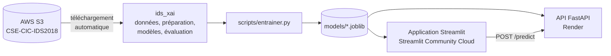

```
├── ids_xai/              Bibliothèque commune (logique extraite du notebook)
│   ├── config.py         Paramètres du projet
│   ├── donnees.py        Acquisition S3 et nettoyage
│   ├── exploration.py    Statistiques et visualisations
│   ├── preparation.py    Sélection des variables, séparation, pipeline de prétraitement
│   ├── modeles.py        Modèles, validation croisée, optimisation
│   ├── evaluation.py     Métriques, courbes, matrice de confusion, seuil
│   ├── explications.py   Explicabilité (permutation, SHAP, LIME, phrase de synthèse)
│   └── artefacts.py      Sauvegarde et chargement des modèles
├── app/                  Application Streamlit (une page par module)
├── api/                  Service FastAPI
├── scripts/              Préparation des données et entraînement
├── tests/                Tests automatisés (données synthétiques au format CIC)
├── notebooks/            Notebook d'analyse
├── data/                 Échantillon nettoyé
├── models/               Modèles entraînés
└── Dockerfile            Image de l'API
```

L'application et l'API partagent la bibliothèque `ids_xai`, ce qui garantit un prétraitement
identique à l'entraînement et en production.

## Installation et exécution

### Prérequis
- Python 3.12 ou 3.13
- L'échantillon nettoyé `data/ids2018_propre.parquet`, ou un accès Internet pour le régénérer

### Installation

```bash
git clone https://github.com/Farahgrissa/ids-xai-classification.git
cd ids-xai-classification
python -m venv .venv
source .venv/bin/activate        # Windows : .venv\Scripts\activate
pip install -r requirements-dev.txt
```

### Préparation des données et entraînement

```bash
python scripts/preparer_donnees.py   # facultatif : régénère l'échantillon depuis AWS S3
python scripts/entrainer.py          # entraîne les 5 modèles et enregistre les artefacts
```

### Lancement

```bash
uvicorn api.main:app --reload        # API : http://localhost:8000/docs
streamlit run app/Accueil.py         # Application : http://localhost:8501
```

### Tests

```bash
pytest -q
```

La suite de tests s'exécute sur des données synthétiques reproduisant le format CSE-CIC-IDS2018 ;
elle est lancée automatiquement par GitHub Actions à chaque modification, avec la construction de
l'image Docker de l'API.

## API

| Méthode | Route | Description |
|---|---|---|
| GET | `/health` | État du service et du modèle |
| GET | `/model-info` | Modèle, variables attendues, seuil, métriques, versions |
| GET | `/exemple` | Exemple de flux au format attendu |
| POST | `/predict` | Probabilité d'attaque et décision pour un ou plusieurs flux |
| POST | `/explain` | Contributions SHAP des variables et phrase de synthèse pour un ou plusieurs flux |

Exemple :

```bash
curl -X POST http://localhost:8000/predict \
     -H "Content-Type: application/json" \
     -d '{"flux": [{"Protocol": "6", "Flow Duration": 18000, "...": "..."}], "seuil": 0.8}'
```

```json
{
  "modele": "XGBoost",
  "seuil": 0.8,
  "resultats": [
    {"probabilite_attaque": 0.9971, "decision": "attaque", "niveau": "critique"}
  ],
  "variables_ignorees": []
}
```

`POST /explain` prend le même corps (avec `top`, le nombre de contributions renvoyées) :

```json
{
  "probabilite_attaque": 0.9836, "decision": "attaque", "niveau": "critique",
  "valeur_de_base": -1.159, "unite": "log-odds",
  "contributions": [
    {"variable": "Fwd IAT Min", "valeur": 8430.0, "valeur_lisible": "8,43 ms", "contribution": 1.408},
    {"variable": "Fwd IAT Mean", "valeur": 8430.0, "valeur_lisible": "8,43 ms", "contribution": 1.185}
  ],
  "phrase": "Le risque d'attaque est élevé (98,4 %, seuil 0,80) principalement à cause de : …"
}
```

## Captures d'écran

### Module 1 – Exploration des données

| Répartition des classes | Distributions |
|---|---|
| 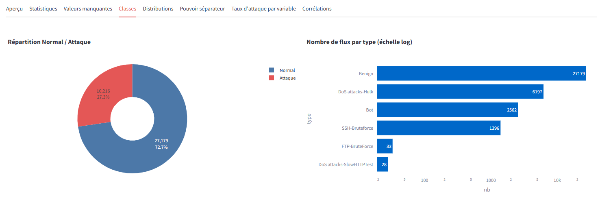 | 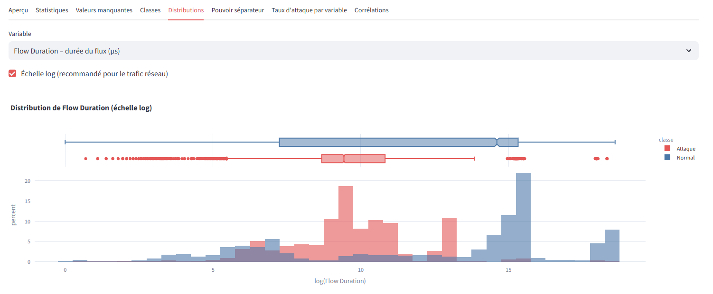 |

| Pouvoir séparateur des variables | Taux d'attaque par variable |
|---|---|
| 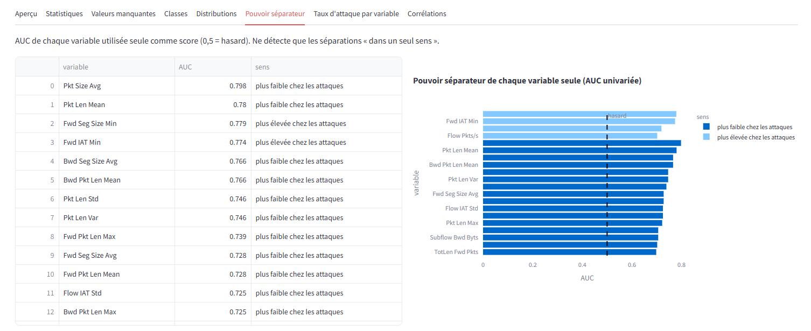 | 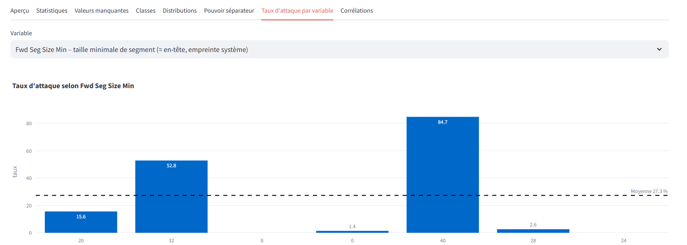 |

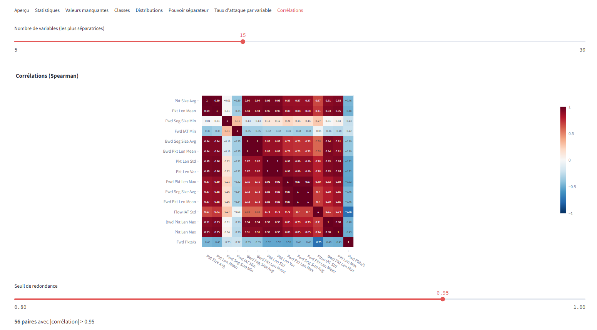
*Corrélations de Spearman entre les variables les plus séparatrices : les blocs fortement corrélés
justifient le retrait des variables redondantes.*

### Modules 2 et 3 – Préparation et modélisation

| Préparation des données | Comparaison des modèles |
|---|---|
| 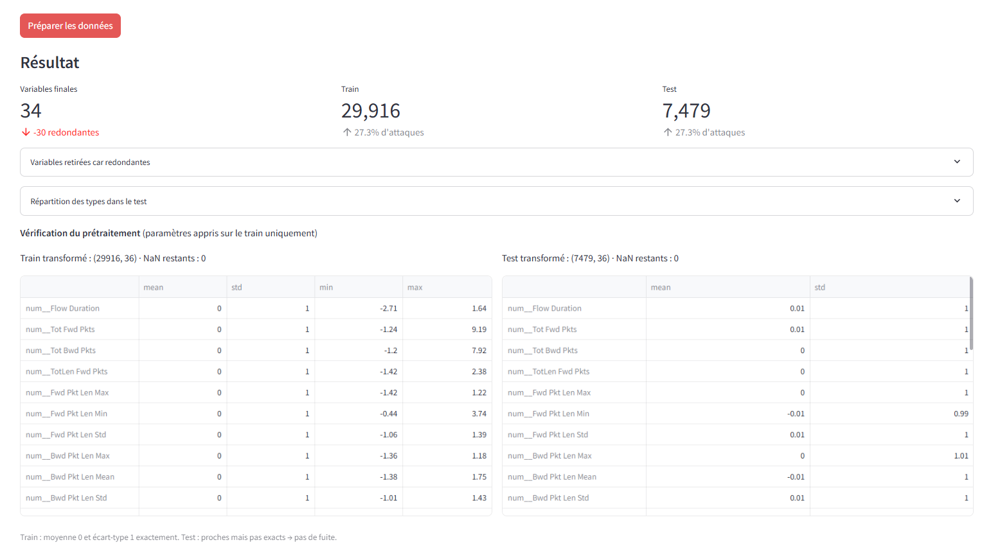 | 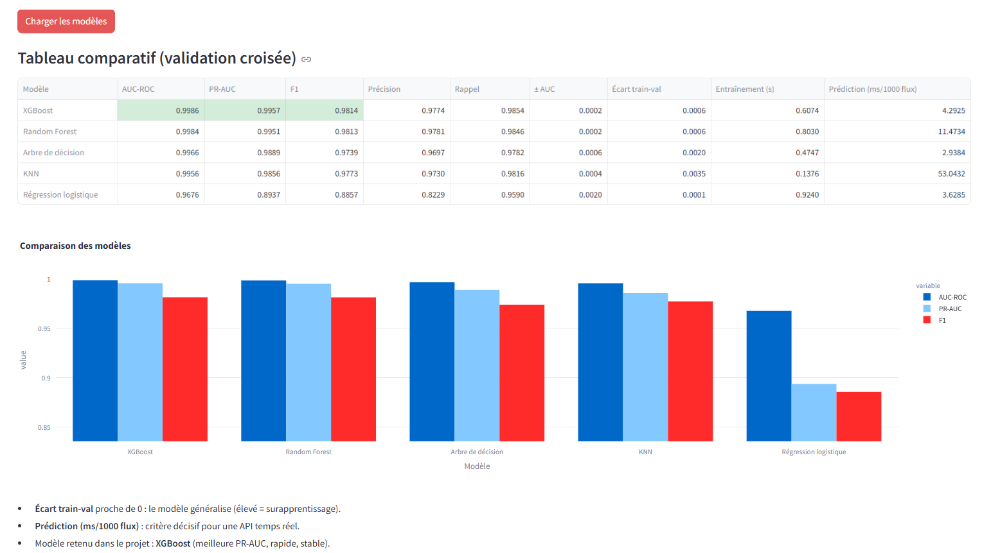 |

### Module 4 – Évaluation

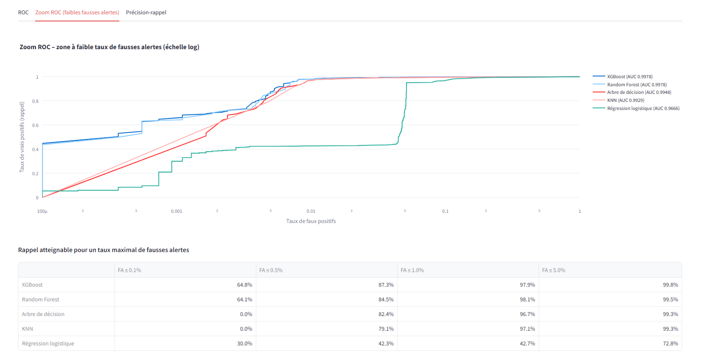
*Zoom sur la zone à faible taux de fausses alertes : XGBoost et Random Forest se détachent nettement
de la régression logistique.*

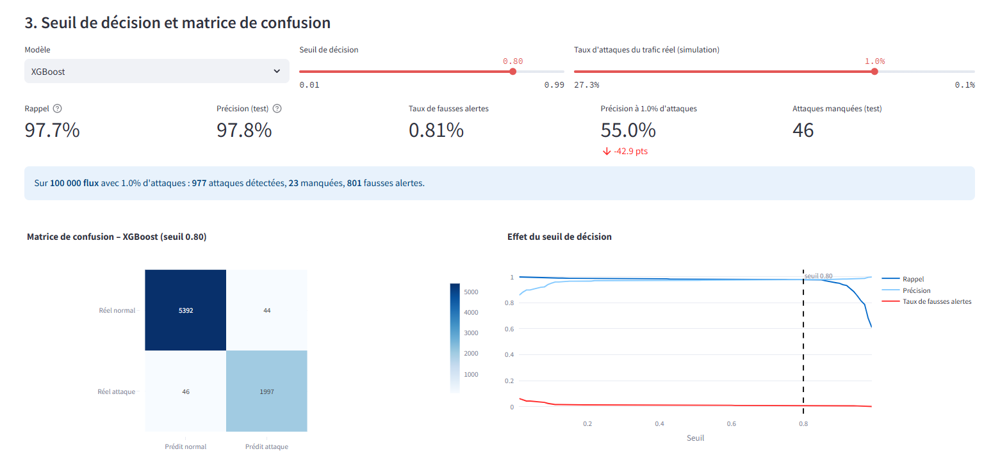
*Effet du seuil de décision et simulation d'un taux d'attaques réaliste (1 %) sur la précision.*

### Module 5 – Explainable AI

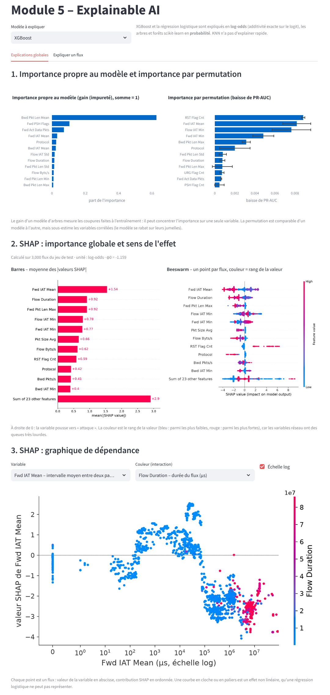
*Importance par permutation et SHAP : le rythme des paquets (`Fwd IAT Mean`) domine.*

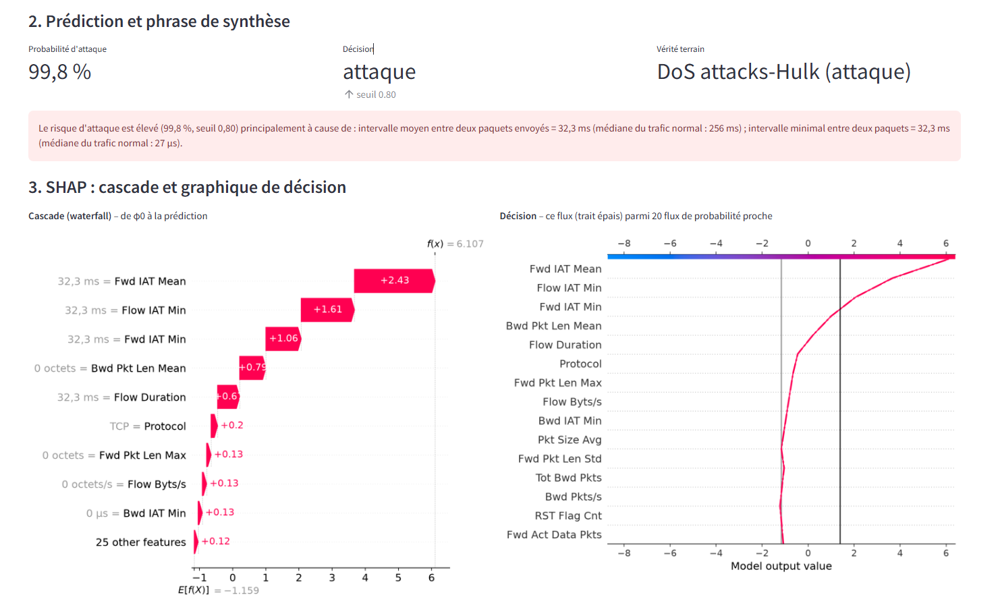
*Phrase de synthèse, cascade SHAP et comparaison avec LIME pour un flux du jeu de test.*

### Module 6 – API

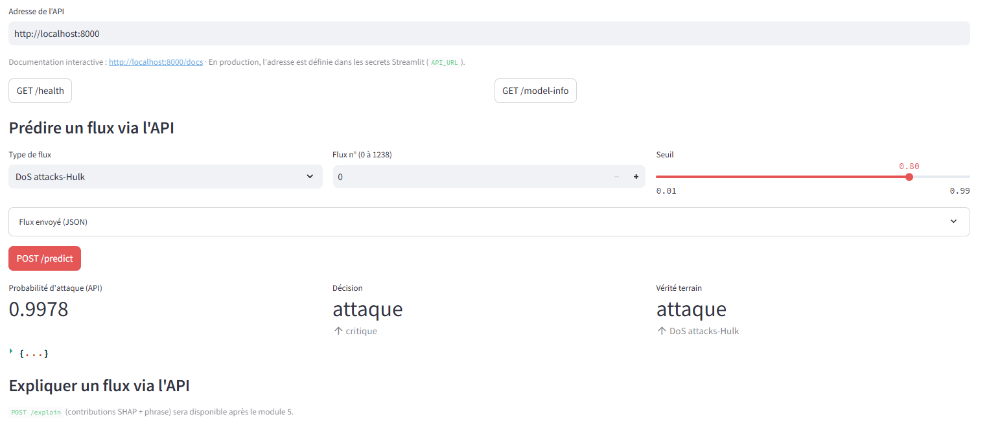
*Prédiction d'un flux du jeu de test par l'API FastAPI, appelée depuis l'application.*

## Limites et perspectives

**Limites**
- Données de laboratoire : attaques générées par des outils automatisés depuis un nombre restreint de
  machines, ce qui facilite leur détection.
- Taux d'attaques de l'échantillon (27 %) très supérieur à celui d'un réseau réel : la précision
  mesurée est optimiste.
- Classification flux par flux : la répétition, caractéristique de la force brute, n'est pas exploitée.
- Absence d'attaque UDP dans l'échantillon : le modèle a appris « UDP = normal », un déni de service
  UDP ne serait pas détecté.
- SHAP explique le modèle, pas la cause réelle d'un flux ; LIME dépend du voisinage choisi.

**Perspectives**
- Évaluation sur des familles d'attaques absentes de l'entraînement (DDoS) pour mesurer la
  généralisation.
- Variables agrégées par source et par fenêtre temporelle.

## Références

- I. Sharafaldin, A. H. Lashkari, A. A. Ghorbani, *Toward Generating a New Intrusion Detection Dataset
  and Intrusion Traffic Characterization*, ICISSP 2018.
- [CSE-CIC-IDS2018 – Registry of Open Data on AWS](https://registry.opendata.aws/cse-cic-ids2018)

## Auteure

**Farah Grissa** – élève ingénieure en informatique, spécialité intelligence artificielle, ENSI ·
[GitHub](https://github.com/Farahgrissa)